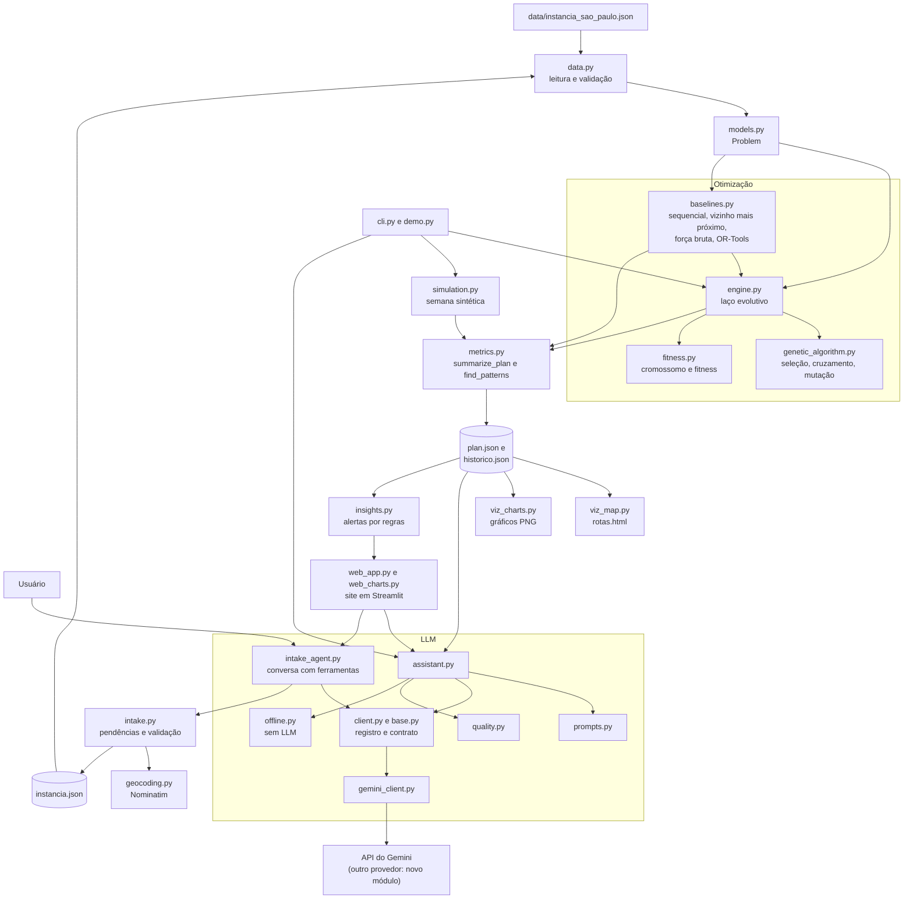
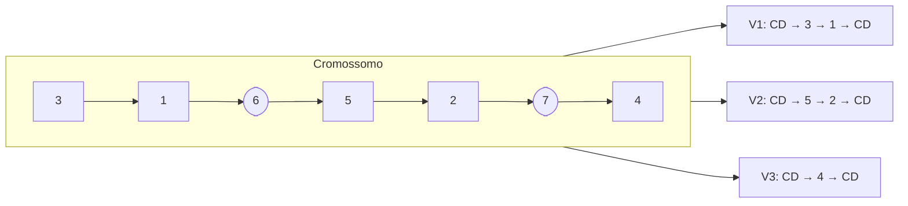
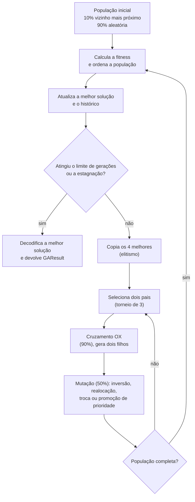
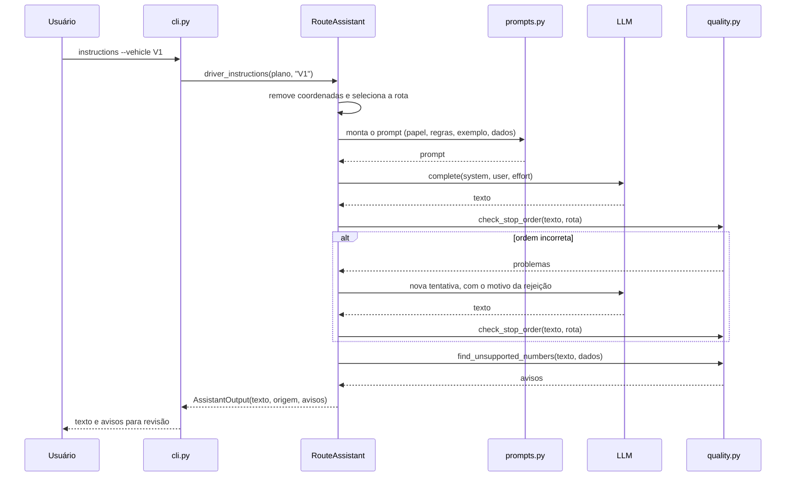
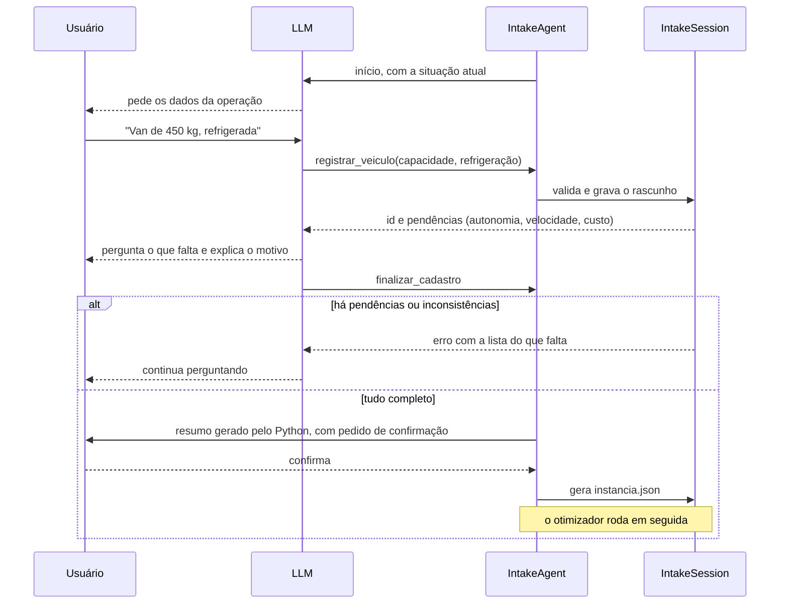

# Arquitetura

Este documento descreve como as partes do projeto se conectam. A justificativa das escolhas e os resultados estão no [relatório técnico](relatorio_tecnico.md).

## Visão geral

A regra central é: **o Python calcula e a LLM redige**. O algoritmo genético decide as rotas. As métricas são calculadas em `metrics.py`. A LLM recebe esses dados prontos e só escreve o texto, o que reduz o risco de números inventados.



## Módulos

| Módulo | Responsabilidade | Depende de |
| --- | --- | --- |
| `models.py` | Entidades e `Problem`, com a matriz de distâncias | biblioteca padrão |
| `data.py` | Lê e valida a instância; sorteia a demanda diária | `models` |
| `fitness.py` | Codifica o cromossomo, simula as rotas e calcula a fitness | `models` |
| `genetic_algorithm.py` | Operadores genéticos, sem conhecer o problema | biblioteca padrão |
| `baselines.py` | Abordagens de comparação e heurística da semente | `fitness`, `models`, `ortools` (opcional) |
| `engine.py` | Laço evolutivo e configuração | `baselines`, `fitness`, `genetic_algorithm` |
| `metrics.py` | Resume o plano e encontra padrões; é a fonte única dos números | `fitness`, `models` |
| `simulation.py` | Simula uma semana | `baselines`, `data`, `engine`, `metrics` |
| `experiments.py` | Comparativo, ablação e sensibilidade | `baselines`, `engine`, `metrics` |
| `viz_map.py`, `viz_charts.py` | Mapa e gráficos, a partir do plano | `folium`, `matplotlib` |
| `insights.py` | Transforma o plano e a semana em alertas com o que fazer | `metrics`, `data` |
| `web_app.py`, `web_charts.py` | Telas e gráficos do site | `streamlit`, `altair`, `insights`, `llm` |
| `intake.py` | Dados do cadastro assistido: pendências, validação e geração da instância | `data`, `geocoding`, `models` |
| `geocoding.py` | Converte endereços em coordenadas | biblioteca padrão |
| `llm/base.py`, `llm/client.py` | Contrato independente de provedor e registro de provedores | biblioteca padrão |
| `llm/gemini_client.py` | Implementação do contrato com o Gemini | `google-genai` |
| `llm/` (demais módulos) | Instruções, relatórios, sugestões, respostas e agente de cadastro | `metrics`, `intake`, contrato |
| `cli.py` | Linha de comando | todos os anteriores |

## Representação do cromossomo

O cromossomo é uma permutação de inteiros. Os genes de 1 a *n* são entregas. Os genes acima de *n* são separadores: cada um encerra a rota de um veículo e passa para o próximo. Com *n* entregas e *m* veículos, há *m* − 1 separadores.

A permutação é a mesma estrutura do código base. Por isso, OX e as mutações continuam gerando indivíduos válidos, sem operadores de reparo.

O diagrama mostra um cromossomo com 5 entregas e 3 veículos, em que 6 e 7 são os separadores:



Separadores vizinhos, ou nas pontas, significam um veículo sem rota. Assim, o algoritmo também decide quantos veículos usar.

## Fluxo do algoritmo genético



## Fluxo da LLM

Este é o fluxo das instruções ao motorista, o mais rigoroso. Os demais pulam a nova tentativa, mas mantêm a verificação de números.



## Fluxo do cadastro assistido

A LLM conduz a conversa e registra os dados por ferramentas. As pendências, a validação e a confirmação ficam no Python, de modo que a LLM não consegue encerrar um cadastro com pendências, com um registro que falhou ou no mesmo turno de um registro. Uma entrega que ela nunca tentou registrar não é detectada: nesse caso, a proteção é a conferência do resumo pelo usuário.



## Como adicionar um provedor de LLM

O restante do projeto usa apenas `LLMClient` e `Conversation`, de `llm/base.py`. Cada provedor guarda o histórico da conversa no próprio formato, então nada fora do módulo dele conhece a API.

1. Crie `medroute/llm/outro_client.py`, com as classes que implementam `complete`, `start_conversation`, `list_models`, `send_user` e `send_tool_results`.
2. Registre o provedor em `medroute/llm/client.py`:

```python
def _outro(model, http_client):
    from .outro_client import OutroClient

    return OutroClient(model, http_client)


PROVIDERS = {
    "gemini": ProviderSpec(_gemini, "gemini-3.5-flash-lite", ("GEMINI_API_KEY", "GOOGLE_API_KEY")),
    "outro": ProviderSpec(_outro, "modelo-padrao", ("OUTRO_API_KEY",)),
}
```

A opção `--llm outro` aparece sozinha na linha de comando. O teste `test_a_new_provider_only_needs_a_registry_entry` verifica esse caminho. O parâmetro `effort` é uma sugestão: um provedor sem esse controle pode ignorá-lo.

## Contratos de dados

`metrics.summarize_plan` gera o dicionário usado pelo mapa, pelos gráficos e pela LLM. Assim, todas as saídas mostram os mesmos números.

```text
plan
├── instance, method, departure, shift_end
├── depot: name, lat, lon
├── totals: distance_km, cost_brl, route_minutes, makespan_min, last_return,
│           vehicles_used, vehicles_total, deliveries, load_kg, on_time_rate_pct,
│           critical_on_time_rate_pct, on_time_by_priority, late_deliveries,
│           fitness, feasible, violations
├── routes[]: vehicle_index, vehicle_id, vehicle_name, refrigerated, capacity_kg,
│             range_km, distance_km, duration_min, return_time, load_kg,
│             capacity_used_pct, range_used_pct, cost_brl
│   └── stops[]: sequence, id, name, kind, lat, lon, item, demand_kg, priority,
│                cold_chain, arrival, deadline, late_min
├── unused_vehicles[]
└── comparison: reference_method, reference_totals e os valores economizados
```

`simulation.simulate_week` gera o histórico, com um registro por dia. `metrics.find_patterns` agrega esse histórico em totais, economia, nível de serviço, atrasos recorrentes e uso da frota.

## Decisões de arquitetura

| Decisão | Motivo | Alternativa descartada |
| --- | --- | --- |
| Separadores no cromossomo | Representa frota heterogênea e cadeia fria sem etapa extra e mantém OX válido | *Giant tour* com divisão posterior: a divisão precisaria considerar veículos diferentes |
| Penalidades, em vez de reparo | Simples, e permite atravessar soluções inviáveis durante a busca | Operadores de reparo: mais código e mais específicos do problema |
| Pacote plano, sem instalação | Roda com `python -m medroute` logo após instalar as dependências | Estrutura `src/` com empacotamento: não traria ganho aqui |
| Contrato próprio, com um módulo por provedor | Cada SDK fica isolado, e recursos específicos, como as assinaturas de raciocínio do Gemini, não vazam para a aplicação | API compatível com a da OpenAI: limita os recursos ao que todos têm em comum |
| Pendências e validação no Python, não na LLM | A LLM pode esquecer um limitador; uma regra em código, não | Confiar só no prompt: uma lacuna viraria uma restrição a menos, sem aviso |
| Ferramentas sem `strict`, com validação em `intake.py` | O cadastro aceita dados parciais, e os valores precisam de validação de negócio de qualquer forma | Esquema estrito com todos os campos obrigatórios: impediria registrar uma informação parcial |
| `generate_content`, e não a Interactions API | O Google a marca como legada, mas com suporte total, e guarda o histórico na aplicação, sem deixá-lo salvo no serviço. A documentação da Interactions API ainda é contraditória sobre o uso em produção | Interactions API: a troca fica restrita a `gemini_client.py`, se for preciso |
| Endereços pelo Nominatim, com `--geocoder none` | O usuário não costuma saber coordenadas, e a LLM não deve estimá-las | Coordenadas estimadas pela LLM: seriam dados inventados |
| Sem RAG vetorial | O plano do dia cabe no contexto, e a busca poderia omitir uma parada | Base vetorial: mais uma dependência, sem benefício nesse volume |
| Sem API REST nem nuvem | O desafio trata esses itens como opcionais; o site local e a CLI cobrem a demonstração | FastAPI e infraestrutura como código |
| Site em Streamlit | Tudo em Python, reaproveitando o `RouteAssistant`, o `IntakeAgent` e o mapa | Frontend separado com API: muito mais código para o mesmo resultado |
| Alertas por regras, não pela LLM | Funcionam sem chave, não gastam cota e não inventam números. A LLM continua nos textos | Pedir os insights à LLM: variam a cada execução e exigiriam validação |
| Site restrito a `localhost` | Não há login, e a chave de API é a da máquina | Publicação aberta: qualquer pessoa gastaria a cota e enviaria dados à LLM |
